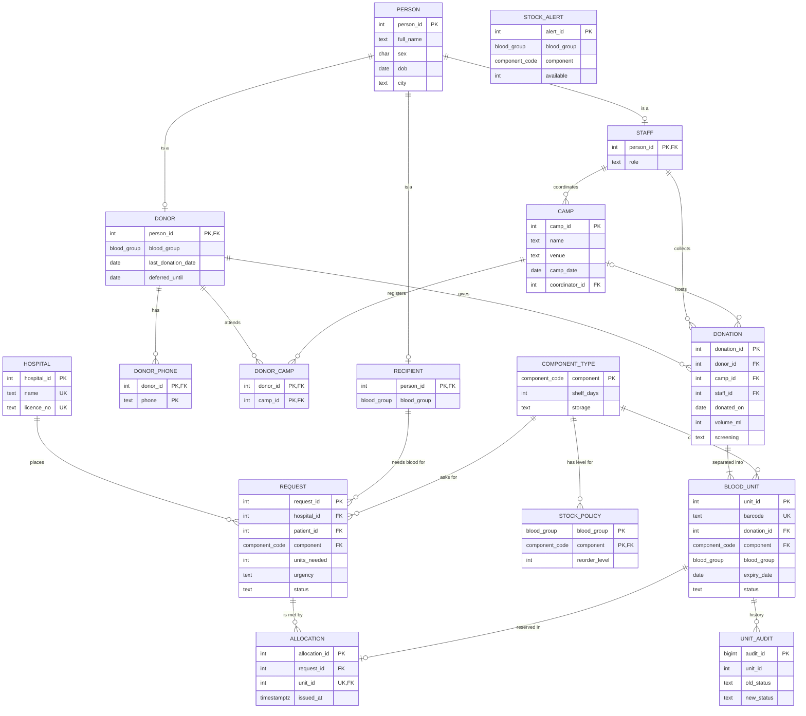

# HemoGrid ER diagram

Renders on GitHub, in VS Code (Markdown Preview Mermaid) or at mermaid.live.

## Extended-ER features used

- **Specialization / generalization**: `PERSON` is the superclass of `DONOR`, `RECIPIENT` and `STAFF`. It is *overlapping* (a staff member can also be a donor) and *partial* (a person need not be any of them). Implemented as one table per subclass sharing the superclass key (the "reduction to relational schema" method for overlapping specialization).
- **Multivalued attributes**: a donor's phones and attended camps become `DONOR_PHONE` and `DONOR_CAMP`.
- **Weak-ish / dependent entity**: `BLOOD_UNIT` cannot exist without its `DONATION` (total participation, `UNIQUE(donation_id, component)`).
- **Derived attribute**: unit `expiry_date` and `blood_group` are computed by a trigger from `COMPONENT_TYPE.shelf_days` and the donor, then stored because a printed label must not change later.
- **Constraints**: cardinalities above, `CHECK` domains (`blood_group`, `component_code`), `UNIQUE(allocation.unit_id)` (a unit is allocated at most once), `UNIQUE(donor_id, donated_on)`.
